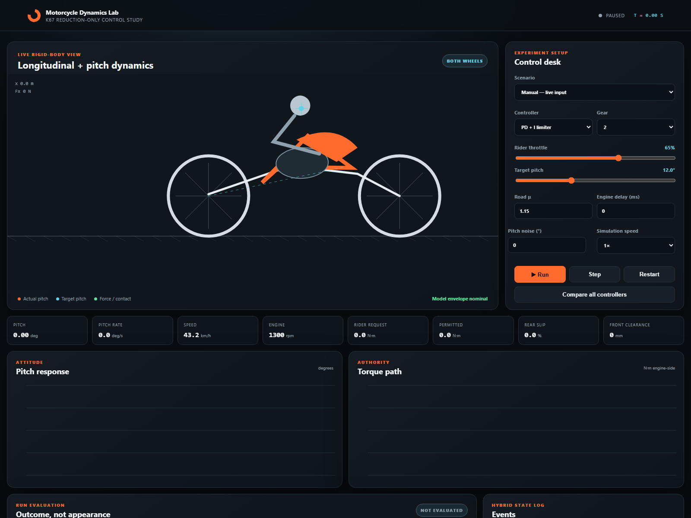

# Motorcycle Dynamics Lab

An interactive, physics-driven research simulator for a rider-assisted, **reduction-only** motorcycle wheelie controller. The target vehicle is a 2020 BMW S1000RR K67 with a rider, but every unmeasured quantity is labeled as an estimate and the software makes no real-world safety claim.



## Run it

Requirements: Node.js 20 or newer. There are no runtime packages to install.

```bash
npm run dev
```

Open `http://localhost:4173`, choose a scenario and controller, then press **Run**. Manual mode accepts live rider throttle, gear, pitch target, friction, delay, sensor noise, and simulation-speed changes.

```bash
npm test                 # physics, controls, convergence, telemetry
npm run experiment       # all scenarios + 30-case sensitivity study
npm run experiment -- ideal
npm run check            # syntax + complete test suite
```

Batch results are written to `results/comparison.csv` and `results/comparison.json`. The browser can export the current run as CSV or JSON.

## What is modeled

- Hybrid ground / rear-contact wheelie dynamics with load-transfer lift-off and impact-like touchdown.
- Rear wheel inertia, longitudinal slip, saturating tire force, aerodynamic drag and rolling resistance.
- Nonlinear grip-to-torque mapping, estimated torque curve, six gears, final drive, engine braking, lag, rate limit and transport delay.
- No assist, threshold, equilibrium-feedforward PD/PID, delay-aware feedback, and constrained nonlinear forward-shooting control.
- Sensor latency, seeded noise, bias, quantization and dropout; command interruption; parameter variation.
- Pitch RMSE, overshoot, peak rate, tolerance time, intervention, saturation, constraint violations and controller timing.
- Offline passive telemetry CSV validation and measured-versus-simulated error calculation.

The hard authority invariant is enforced in the plant, not merely requested of controllers:

```text
0 ≤ permitted positive engine torque ≤ rider-requested positive engine torque
```

Closing the grip retains modeled engine braking. The controller cannot add positive torque when rider demand is insufficient.

## Architecture

```text
Rider/scenario ──► engine request ──► supervisory torque ceiling
                                             │
                                             ▼
sensor model ◄── hybrid motorcycle plant ◄── engine + drivetrain
     │                   │
     └──── controller ◄──┘──► metrics / plots / CSV / JSON
```

| Area | Location |
|---|---|
| Vehicle, engine and tire dynamics | `src/physics/` |
| Controllers | `src/controllers/` |
| Sensor nonidealities | `src/sensors/` |
| Scenarios and deterministic runner | `src/simulation/` |
| Metrics and telemetry import | `src/analysis/`, `src/telemetry/` |
| Browser application | `index.html`, `styles.css`, `src/app.js` |
| Engineering explanation | [`docs/engineering-report.html`](docs/engineering-report.html) |

## Verified status

The current suite contains 18 deterministic tests covering force bounds, lift-off, gravity-driven touchdown, torque authority, controller fallback, timestep refinement, reproducibility and telemetry validation. `npm run check` and the complete experiment matrix were run on November 4, 2026.

The central result is intentionally mixed: the PD controller tracks the 11.5° ideal, near-delay-free case in this model (2.54° airborne RMSE and 0.99° overshoot), while the same concept fails or becomes only partial under excessive demand, 100 ms transport delay, faults, noise and insufficient traction. The included lightweight predictive controller is a transparent research baseline and did not outperform the tuned PD controller.

## Safety and scope

This is a reduced-order educational research model. It has not been identified against a real K67, has no ECU connection, and is not evidence that a motorcycle can be operated safely with this control concept. Do not use its parameters or controller gains on a vehicle.

