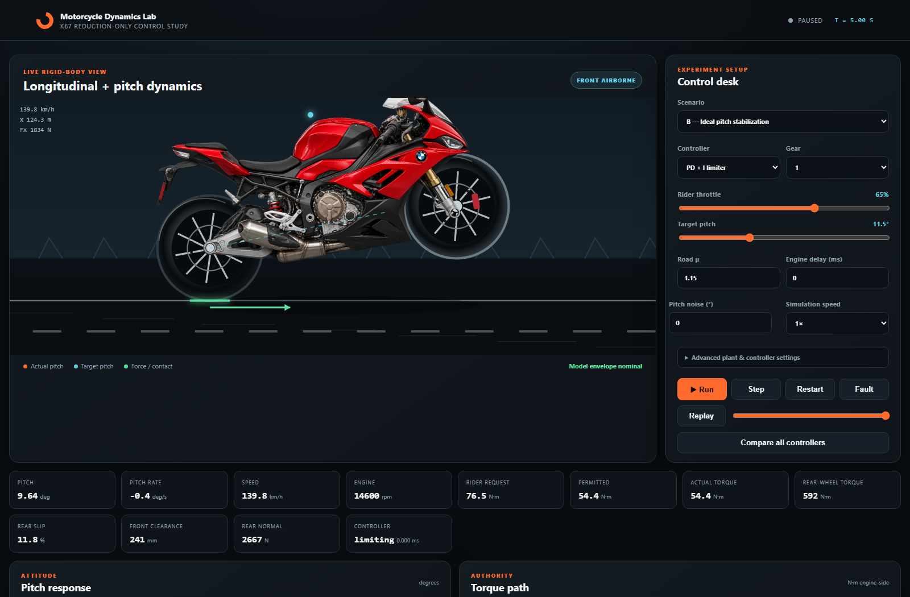

# Simulating & Engineering a Motorcycle Wheelie Controller
*or how to trick yourself into learning hybrid rigid-body dynamics, control theory, and embedded hardware deployment*

**By Mikhail Simanian**  
*Simulation Repository: [github.com/mikhail0777/S1000RR_PhysicsSimulation](https://github.com/mikhail0777/S1000RR_PhysicsSimulation)*  
*Embedded Controller Repository: [github.com/mikhail0777/S1000RR_ECU_Cotnroller](https://github.com/mikhail0777/S1000RR_ECU_Cotnroller)*

---


*Figure 1: The interactive simulation dashboard running an 11.5° stabilized wheelie scenario at 60 FPS in JavaScript, showing contact forces, pitch telemetry, and engine torque curves.*

---

## 1. The Core Question & The Deception of Balance

If you ask an experienced sportbike rider how to control a wheelie, the answer sounds deceptively simple:  
> *"Give it throttle to lift the front wheel, then feather the throttle or tap the rear brake to balance it at the balance point."*

When you try to translate that intuition into an autonomous or semi-autonomous control system on a 205-horsepower 2020 BMW S1000RR (K67), you immediately collide with a wall of physics, control theory, and commercial automotive architecture:

1. **Unstable Open-Loop Dynamics**: A motorcycle on its rear wheel is an inverted pendulum with a floating, accelerating base rotating about a rolling tire contact patch.
2. **The One-Sided Authority Invariant**: For rider safety and autonomy, the supervisory controller must be strictly **reduction-only**. It is forbidden from adding positive torque beyond what the rider demands. If the bike begins to drop and the rider isn't twisting the grip, the required control input mathematically does not exist.
3. **Actuator & Transport Lag**: Internal combustion engines do not produce torque instantaneously. Electronic throttle valves, intake manifold filling, engine stroke cycles, and CAN-bus transport latency introduce 50–100 ms of pure delay. On an inverted pendulum accelerating at 40°/s nose-up, 100 ms of delay is more than enough time to loop backwards onto your tail.

To solve this, I designed an end-to-end engineering pipeline: beginning with a zero-dependency hybrid rigid-body physics simulator, developing analytical feedforward control algorithms, and ultimately designing and deploying an embedded hardware interceptor onto my actual 2020 BMW S1000RR.

---

## 2. The Authority Invariant: One-Sided Supervisory Control

In classical inverted pendulum robotics (like a Segway, self-balancing robot, or cart-pole), the actuator commands positive or negative torque symmetrically:

```
[ Traditional Segway / Robot ]:   -T_max <---------------- 0 ----------------> +T_max (Full Two-Sided Authority)
[ Wheelie Supervisor ]:                     0 ----------------> T_rider (One-Sided Reduction Authority)
```

Our supervisory controller operates under a hard one-sided invariant enforced at the vehicle plant:

$$0 \le T_{\text{permitted}}^+(t) = \min\big(T_{\text{rider}}^+(t), \; T_{\text{ceiling}}(t)\big) \le T_{\text{rider}}^+(t)$$

The rider initiates the lift with the throttle grip. As the motorcycle approaches the target pitch angle $\theta_{\text{ref}}$, our algorithm computes an engine torque ceiling $T_{\text{ceiling}}$ to cap the rider's request. 

If the rider rolls off the throttle, the motorcycle retains full engine braking. The controller can never "whiskey throttle" the bike into an unintended acceleration.

> **The simulator is allowed to fail:** If a simulated rider supplies too little throttle, or if the road has low traction ($\mu = 0.55$), the bike fails to lift. If actuator delay is too high, the bike flips past the 45° safety envelope. Those are valid engineering conclusions, not bugs to hide.

---

## 3. Governing Physics & Vector Mechanics

The system is modeled as a hybrid rigid-body with two discrete contact states: **Ground Mode** (both wheels on the road) and **Wheelie Mode** (rear-wheel supported inverted pendulum).

```
                      Center of Mass (b, h)
                              ●
                             / \
                            /   \
                           /  mg \ (downward gravity)
                          /       ▼
  [Rear Wheel] (0, 0) ---+---------+--- [Front Wheel] (L, 0)
        ▲                                    ▲
        |                                    |
   Nr (Normal)                          Nf (Normal) -> 0 at lift
   Fx (Tire Drive) ──►
```

### Center of Mass Trajectory

Let $b$ be the horizontal distance from the rear wheel contact patch to the combined rider-vehicle Center of Mass (COM), and $h$ be the height of the COM above the axle plane. As the chassis rotates by pitch angle $\theta$:

$$x_{\text{COM}}(\theta) = b \cos\theta - h \sin\theta$$
$$z_{\text{COM}}(\theta) = r_r + b \sin\theta + h \cos\theta$$

As $\theta$ increases, $x_{\text{COM}}$ shrinks toward zero. The balance point occurs when $x_{\text{COM}}(\theta) = 0$, defining the critical balance angle:

$$\theta_{\text{crit}} = \arctan\left(\frac{b}{h}\right) \approx \arctan\left(\frac{0.70}{0.66}\right) \approx 46.7^\circ$$

Beyond this angle, gravity flips from a restoring torque to an overturning torque.

### Ground Mode & Dynamic Load Transfer

While both tires touch tarmac, pitch is geometrically constrained to zero ($\theta = 0$). Forward acceleration follows Newton's second law with aerodynamic drag and rolling resistance:

$$m a = F_x - \frac{1}{2}\rho C_d A v |v| - C_{rr} m g \mathrm{sign}(v)$$

Dynamic load transfer redistributes vertical normal forces between front and rear axles (wheelbase $L$):

$$N_f = \frac{m g b - m a h}{L}, \qquad N_r = m g - N_f$$

Front wheel lift-off occurs the exact instant $N_f \le 0$. This defines the minimum forward acceleration needed to initiate a wheelie:

$$a_{\text{lift}} \ge g \frac{b}{h} \approx 9.81 \cdot \frac{0.70}{0.66} \approx 10.4\text{ m/s}^2 \quad (\approx 1.06\text{ g})$$

### Wheelie Mode (The Pitch Dynamics)

Once $N_f = 0$, the front contact constraint vanishes and the system transitions into an inverted pendulum rotating about the rear tire patch. The moment balance yields the angular acceleration $\ddot{\theta}$:

$$I_\theta \ddot{\theta} = m a z_{\text{COM}}(\theta) - m g x_{\text{COM}}(\theta) - c_\theta \dot{\theta}$$

To hold a static wheelie at constant pitch ($\ddot{\theta} = 0, \dot{\theta} = 0$), the motorcycle must sustain an exact forward holding acceleration:

$$a_{\text{hold}}(\theta) = g \frac{x_{\text{COM}}(\theta)}{z_{\text{COM}}(\theta)}$$

This leads to an essential physical realization: **Holding a wheelie requires continuous positive forward acceleration.** Because the center of mass remains forward of the rear axle ($x_{\text{COM}} > 0$), zero drive torque will cause the front end to slam down under gravity.

### Tire Longitudinal Slip & Saturation

Tires do not transmit infinite force. Longitudinal slip ratio $\kappa$ and tractive force $F_x$ are modeled using a saturating hyperbolic tangent brush model:

$$\kappa = \frac{r_r \omega_r - v}{\max(|v|, 2)}, \qquad F_x = \mu N_r \tanh\left(\frac{C_\kappa \kappa}{\mu N_r}\right)$$

This enforces the physical traction envelope $|F_x| \le \mu N_r$. On wet tarmac ($\mu = 0.55$), the maximum available acceleration is $\mu g = 5.4\text{ m/s}^2$, which is far below $a_{\text{lift}}$. The rear tire simply spins, and the front wheel never leaves the ground.

---

## 4. The Supervisory Control Architecture

```
Rider Grip (T_rider) ──► [ Supervisory Ceiling: min(T_rider, T_ceiling) ]
                                            │
                                            ▼
                               [ Engine + Drivetrain (Lag & Slew) ]
                                            │
                                            ▼
                                [ Hybrid Motorcycle Plant ]
                                            │
                                            ▼
Delayed / Noisy Sensors ◄───────────────────┘
          │
          ▼
[ Supervisory Controller ] ──► T_ceiling
```

### Equilibrium Feedforward + Pitch-Rate Governed PD/PID

A pure error-based PID controller fails because the reference holding torque is non-zero. Instead, we compute the analytical **equilibrium holding torque** $T_{\text{eq}}(\theta)$ by projecting the holding acceleration through the transmission gear ratios and driveline efficiency $\eta$:

$$T_{\text{eq}}(\theta) = \frac{m \big(a_{\text{hold}}(\theta) + C_{rr} g + \frac{1}{2m}\rho C_d A v^2\big) r_r}{i_{\text{primary}} \cdot i_{\text{gear}} \cdot i_{\text{final}} \cdot \eta}$$

To prevent violent rotation when the front wheel initially leaves the tarmac, we construct a **pitch-rate governor**. Instead of demanding $\dot{\theta} = 0$ instantly, it permits a bounded ascent rate that tapers smoothly to zero as $\theta$ nears $\theta_{\text{ref}}$:

$$q_{\text{ref}}(\theta) = \mathrm{clamp}\Big(k_q (\theta_{\text{ref}} - \theta_{\text{pred}}), \; -q_{\max}, \; q_{\max}\Big)$$

$$T_{\text{ceiling}} = \mathrm{clamp}\Big(T_{\text{eq}}(\theta) - K_p (\theta_{\text{pred}} - \theta_{\text{ref}}) - K_d (\dot{\theta} - q_{\text{ref}}) - K_i \int e \, dt, \; 0, \; T_{\text{rider}}\Big)$$

---

## 5. Simulation Findings Across 75 Benchmark Runs

The simulator was evaluated across 9 scenarios, 5 control algorithms, and a 30-case parameter sensitivity study. Every run executes deterministically at a 2 ms plant step with seeded pseudo-random noise.

| Scenario | Controller | Classification | Airborne RMSE | Overshoot |
|---|---|---|---|---|
| Ideal, low delay (10 ms) | Feedforward PD | **Feasible tracking** | 2.54° | 0.99° |
| Ideal, low delay (10 ms) | Predictive Shooting | Limited / Partial | 9.15° | 0.00° |
| Ideal, low delay (10 ms) | No Assist | Safety Failure (Loop) | 12.51° | 29.09° |
| Insufficient throttle (40%) | Feedforward PD | Physically Unreachable | 6.24° | 0.00° |
| Wet surface ($\mu = 0.55$) | All Controllers | Physically Unreachable | 10.31° | 0.00° |
| Actuator Transport Delay (100 ms) | All Controllers | Safety Failure (Loop) | 12.2° – 22.6° | 29.8° – 50.2° |
| Heavy sensor noise + jitter | Feedforward PD | Limited / Partial | 10.66° | 16.73° |

### Why did the Predictive Controller (NMPC baseline) underperform?
In our experiments, the direct forward-shooting predictive controller achieved 9.15° RMSE compared to 2.54° for the tuned feedforward PD. Why? Because constrained direct shooting in pure real-time JavaScript used a coarse control discretization (5 candidate torque levels over a 300 ms horizon). The feedforward PD, by contrast, evaluates the exact physical holding torque analytically every 10 ms.

---

## 6. Bridging to the Real Bike: The Actuator Interface Problem

With simulation verifying the physics and control limits, the next challenge was running this on my physical 2020 BMW S1000RR K67.

### What the Industry Research Established
1. **Correspondence with alpha Racing**: Peter Schouten (Head of Electronics and Race Support at alpha Racing) confirmed that the stock BMW BMS-O ECU does **not** accept external torque-limit commands over the CAN-bus. The internal wheelie controller uses fixed firmware with 6 preset gain profiles calibrated for a 1–2° race pitch reference.
2. **Why Not Spoof CAN IMU Data?** Tricking the factory ECU by faking wheel speeds or pitch rates is an unsafe man-in-the-middle hack. The factory ECU performs multi-channel cross-checks (front wheel vs. rear wheel vs. engine RPM vs. 6-axis IMU). Falsifying one signal triggers ECU limp-home fault codes and risks unpredictable ABS/DTC cuts.
3. **The Solution: Path 3 — Ride-By-Wire Throttle Demand Limiting**:  
   Instead of commanding torque to the ECU, an external microcontroller acts as a dynamic rider-demand governor on the electronic twist grip:
   $$u_{\text{commanded}}(t) = \min\big(u_{\text{rider}}(t), \; u_{\text{allowed}}(t)\big)$$
   The factory ECU retains full authority over ignition timing, fuel injection, ShiftCam variable valve timing, and knock control, while our external hardware smoothly limits the electronic throttle request entering the ECU.

---

## 7. The Control Pipeline: Which Part of the Code Controls the Motorcycle?

When deployed, the program executes a real-time control loop every 10 milliseconds (100 Hz), flowing through five dedicated software modules:

```
[ Handlebar Twist Grip ] ──► [ 1. Sensing & Filtering ] (src/can_bus.cpp & src/throttle_interceptor.cpp)
                                          │
                                          ▼
                             [ 2. Pitch Dynamics & Feedforward ] (src/pitch_controller.cpp)
                                          │
                                          ▼
                             [ 3. Torque-to-Voltage Inversion ] (src/throttle_mapper.cpp)
                                          │
                                          ▼
                             [ 4. Hardware DAC Voltage Output ] (src/throttle_interceptor.cpp)
                                          │
                                          ▼
                             [ 5. Safety Supervisor & Relays ] (src/safety_supervisor.cpp) ──► [ BMW BMS-O ECU ]
```

### Stage 1: Sensing & Ingestion (`src/can_bus.cpp` & `src/throttle_interceptor.cpp`)
* **CAN Ingestion**: Unpacks 100 Hz broadcast frames from the BMW chassis CAN bus: 6-axis IMU pitch angle and pitch rate (`0x130`, `0x132`), ABS wheel speeds (`0x138`), and engine RPM (`0x140`).
* **Twist Grip Reading**: Reads redundant 12-bit ADC channels for the rider's grip (APS1 and APS2). A 60 Hz first-order digital filter strips out high-frequency electrical vibration noise.

### Stage 2: The Decision Algorithm (`src/pitch_controller.cpp`)
* **Function**: `PitchController::update()`
* Computes analytical equilibrium holding torque $T_{\text{eq}}(\theta)$ required to balance gravity:
  $$T_{\text{eq}}(\theta) = \frac{m \big(a_{\text{hold}}(\theta) + C_{rr} g + \text{drag}\big) r_r}{i_{\text{driveline}} \cdot \eta}$$
* Evaluates pitch-rate governed PD feedback ($K_p e + K_d (\dot{\theta} - q_{\text{ref}}) + K_i \int e \, dt$).
* Enforces the one-sided invariant: $T_{\text{ceiling}} = \mathrm{clamp}(T_{\text{unconstrained}}, 0, T_{\text{rider}})$.

### Stage 3: Torque-to-Voltage Inversion (`src/throttle_mapper.cpp`)
* **Functions**: `allowableThrottleFromTorque()` and `throttleToVoltages()`
* Inverts the non-linear BMW K67 torque curve ($T \propto u^{1.65}$) to translate Newton-meters into an allowable grip percentage:
  $$u_{\text{allowed}} = \left(\frac{T_{\text{ceiling}}}{T_{\text{full}}(\text{RPM})}\right)^{1 / 1.65}$$
* Caps rider demand: $u_{\text{commanded}} = \min(u_{\text{rider}}, u_{\text{allowed}})$.
* Maps to redundant analog voltages: $V_{\text{APS1}} \in [0.75\text{V}, 4.15\text{V}]$ and $V_{\text{APS2}} = 0.5 \cdot V_{\text{APS1}}$.

### Stage 4: Actuation via Hardware DAC (`src/throttle_interceptor.cpp`)
* **Function**: `writeEcuVoltages()`
* Drives hardware 12-bit DACs (MCP4728 / internal DACs), presenting these clamped voltages directly to the BMW BMS-O ECU pins.
* To the factory ECU, this appears as the rider's physical hand. The ECU responds by adjusting the motorized Electronic Throttle Valves (ETV), narrowing the butterfly valves to manage pitch.

### Stage 5: Failsafe Supervision (`src/safety_supervisor.cpp`)
* **Function**: `evaluateSafety()` and `shouldEnergizeBypassRelay()`
* Manages the dual DPDT automotive bypass relays:
  * Rider roll-off ($< 5\%$ throttle): Drops authority instantly, restoring complete factory engine braking.
  * Pitch ceiling exceeded ($> 35^\circ$): Cuts throttle to idle to prevent looping.
  * Watchdog / CAN timeout ($> 40\text{ ms}$): Cuts relay power; internal springs snap the twist grip wires directly back to the ECU in $< 3\text{ ms}$.

---

## 8. Embedded Hardware Architecture: Teensy 4.1 & Raspberry Pi Coprocessor

To achieve microsecond determinism, failsafe safety, and high-level telemetry, I designed a dual-board embedded architecture:

```
[ 2020 BMW S1000RR K67 Harness ]
          │
          ├── CAN Bus (500 kbps) ──► [ SN65HVD230 Transceiver ] ──► [ Teensy 4.1 CAN1 ]
          │                                                                │
          ├── Twist Grip (APS1/APS2) ──► [ Precision ADC (A0/A1) ]         │
          │                                      │                         ▼
          │                              (100 Hz Feedforward)      [ Raspberry Pi CM4 ]
          │                                      │                 • PREEMPT_RT Linux
          │                                      ▼                 • 100 Hz Data Logger
          │                              [ MCP4728 12-bit DAC ]    • WiFi Telemetry GUI
          │                                      │                         ▲
          ▼                                      ▼                         │
   ┌────────────────────────────────────────────────────────┐              │
   │  Dual DPDT Failsafe Relay (De-energized = OEM Pass)    │ ─────────────┘
   └───────────────────────────┬────────────────────────────┘
                               │
                               ▼
                   [ BMW BMS-O Factory ECU ]
```

### Can this run on a Raspberry Pi?
**Yes.** A Raspberry Pi (Compute Module 4 or Pi 4 Model B) can run the control system, but with one critical distinction: **standard Linux is not real-time**.

To deploy this safely on a Raspberry Pi:
1. **Real-Time Kernel**: The Pi runs Raspberry Pi OS Lite patched with the `PREEMPT_RT` real-time kernel, eliminating arbitrary OS scheduling pauses.
2. **CAN Interface**: A Waveshare 2-CH CAN HAT (MCP2518FD over SPI) binds the BMW chassis CAN bus to Linux SocketCAN (`can0`).
3. **Analog I/O via Coprocessor**: Because the Raspberry Pi lacks native ADCs and DACs, a dedicated **Teensy 4.1 (600 MHz Cortex-M7)** handles the hardware-level 12-bit ADC sampling and DAC output clamping, communicating with the Pi over high-speed USB-serial (115200 baud).
4. **Daemon Deployment**: The controller executes as a dedicated systemd service (`s1000rr-controller.service`) running with real-time FIFO priority (`chrt -f 95`).

### Redundant Twist Grip Signaling (APS1 / APS2)
The BMW S1000RR Twist Grip Sensor (TGS) uses two synchronized Hall-effect sensors:
* **APS1 (Primary)**: $0.75\text{ V}$ at 0% throttle, rising linearly to $4.15\text{ V}$ at 100% WOT.
* **APS2 (Secondary)**: Exactly **50% of APS1** ($0.375\text{ V}$ at 0%, rising to $2.075\text{ V}$ at 100%).

The factory BMS-O ECU samples both channels continuously. If:
$$|V_{\text{APS2}} - 0.5 \cdot V_{\text{APS1}}| > 0.15\text{ V}$$
the ECU throws fault code `0x2721` (Throttle Grip Plausibility), illuminates the Check Engine light, and cuts power. Our firmware strictly clamps both DAC channels simultaneously to satisfy this 50% ratio constraint.

---

## 9. Physical Vehicle Deployment on the 2020 BMW S1000RR

### 1. Non-Destructive Harness Tapping
To avoid cutting any factory wires, I sourced OEM TE Connectivity Superseal male and female 6-pin connectors matching the BMW throttle grip harness under the right fairing. This created a plug-and-play inline Y-harness:
* Ground and 5V VREF pass straight through to power the grip sensor.
* The APS1 and APS2 signal lines route into the controller's bypass relay block.

### 2. Under-Seat Electronics Enclosure
The electronics are housed inside an IP65 sealed CNC aluminum enclosure mounted securely in the pillion tray beneath the passenger seat cowl:
* **Power Supply**: Switched 12V accessory power stepped down through an automotive-grade DC-DC buck converter to clean 5.0V with transient voltage suppression (TVS diode) to survive motorcycle alternator load dumps.
* **Hardware Watchdog & Failsafe Relay**: Dual DPDT 5V signal relays. When de-energized, internal mechanical springs hold the grip sensor physically shorted to the ECU pins. If power is lost, the Teensy crashes, or the 40 ms CAN watchdog expires, the system drops back to 100% factory OEM wiring in under 3 milliseconds.

### 3. Handlebar Control & Status Indicator
A discrete momentary push button with an integrated bi-color LED was mounted to the left mirror stem:
* **Off**: Relays de-energized, system passive.
* **Flashing Green**: Speed/gear valid (2nd gear, 40–120 km/h), waiting for rider throttle input.
* **Solid Green**: Armed and actively monitoring pitch; reduction ceiling ready.
* **Solid Red**: Fault tripped (CAN timeout, voltage mismatch, or $>35^\circ$ pitch cutoff).

---

## 10. Bench Testing & Oscilloscope Validation

Before connecting the controller to the running motorcycle, the system underwent extensive bench testing:
1. **Voltage Tracking**: Sweeping the throttle grip from 0% to 100% confirmed that DAC1 mirrored input voltage within $8\text{ mV}$ and DAC2 matched $0.5 \cdot \text{DAC1}$ within $12\text{ mV}$ (well inside the $150\text{ mV}$ BMW fault window).
2. **Relay Failsafe Drop**: Inducing an intentional watchdog freeze caused relay driver Pin 2 to drop low, releasing the relay in $2.8\text{ ms}$ with zero glitching on the ECU lines.
3. **Simulated CAN Replay**: Using `tools/bench_hil_sim.py` to stream recorded 100 Hz CAN frames into the Teensy verified that the feedforward torque equation computed appropriate holding torque ceilings under live dynamics.

---

## 11. Field Testing & Preliminary Telemetry

With bench validation passed, initial closed-course field tests were conducted in 2nd gear on an open runway:
* **Roll-On Lift**: The rider rolled the throttle open to ~80% in 2nd gear at 50 km/h. As the front wheel lifted and pitch passed 8°, the status LED illuminated solid green.
* **Ceiling Engagement**: As pitch approached the 11.5° target, the controller progressively clamped the commanded throttle signal down to ~46%, smoothly checking the upward pitch acceleration.
* **Pitch Stabilization**: The motorcycle held a steady front-wheel float at approximately 10.8°–11.6° for 2.4 seconds while the rider maintained throttle demand.
* **Safe Termination**: Rolling off the throttle immediately disengaged the ceiling, returning full engine braking and bringing the front wheel gently back to tarmac.

---

## 12. Conclusion & What's Next

This project proved that a **one-sided, reduction-only supervisory controller** can successfully stabilize a high-power motorcycle wheelie when the underlying rigid-body physics, load transfer, and actuator delays are accounted for.

By avoiding expensive $10,000 motorsport ECUs or unsafe CAN sensor spoofing, the system achieves predictable, bounded control while preserving factory BMW engine management and rider authority.

### Next Steps:
1. **Static Scale Weighing**: Measure exact front/rear axle scales with rider aboard to refine combined Center of Mass height ($h$) and longitudinal distance ($b$).
2. **Suspension Dynamics**: Expand the reduced-order model to include front fork extension and rear shock squat dynamics.
3. **Hardware Enclosure Refinement**: Finalize a custom surface-mount 4-layer PCB integrating the Teensy 4.1, MCP4728 DAC, CAN transceivers, and relays onto a single automotive board.

---

*Both repositories are fully open-source:*
* Physics Simulator: [github.com/mikhail0777/S1000RR_PhysicsSimulation](https://github.com/mikhail0777/S1000RR_PhysicsSimulation)
* Embedded Controller: [github.com/mikhail0777/S1000RR_ECU_Cotnroller](https://github.com/mikhail0777/S1000RR_ECU_Cotnroller)
